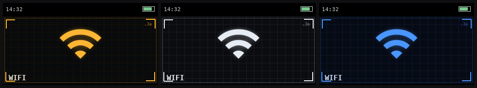
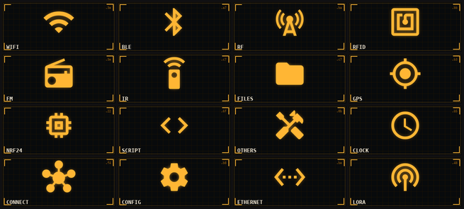
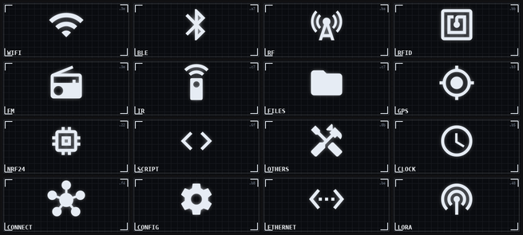
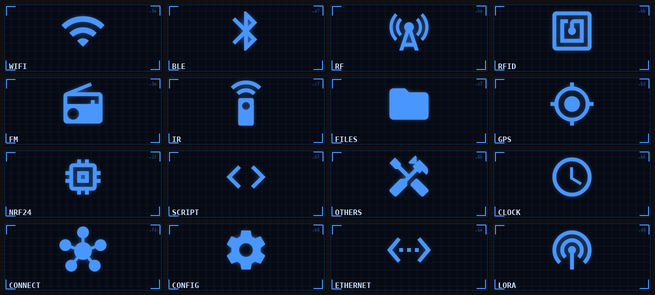

# 🎛️ Bruce HUD Themes

🇺🇸 <b>English</b> · 🇫🇷 <a href="README.fr.md">Français</a>

  

"Instrument / HUD" UI themes for the **[Bruce](https://github.com/BruceDevices/firmware)** firmware, designed for the **LilyGO T-Embed CC1101** (320×170 screen). Each menu entry shows a **clean technical icon** (Material icon set) on a "blueprint" background with a **subtle animated light sweep**.

Three colorways included:

| Theme | Colorway | Preview |
|-------|---------|--------|
| **Amber HUD** | Amber / retro instrument | [view](docs/amber.png) |
| **White HUD** | White / clean | [view](docs/white.png) |
| **Blue HUD** | Blue / cyber | [view](docs/blue.png) |

### Amber HUD

### White HUD

### Blue HUD

## 📦 Contents

Each theme (`Amber HUD/`, `White HUD/`, `Blue HUD/`) contains **16 animated GIFs** (320×140) + its `.json`, covering the 16 Bruce menu entries:
WiFi, BLE, RF, RFID, FM, IR, Files, GPS, NRF24, Interpreter, Others, Clock, Connect, Config, Ethernet, LoRa.

- Animated GIFs with a discreet light sweep (~12 frames, ~45 KB per icon).
- Menu name **baked into the image** (`label: 0`) → text to the right of / below the icon depending on the layout.
- Icons resized and centered with margins → **nothing spills off the screen**.

## 🚀 Installation

### From the SD card
1. Copy the folder of the theme you want (e.g. `Amber HUD`) to the root of the SD card.
2. On the device: **Config → UI Theme → `Amber HUD/Amber HUD.json`**.

### From the WebUI (WiFi)
**Files → WebUI**, connect, upload the folder to the SD card or LittleFS, then select the `.json` in **Config → UI Theme**.

## 🖥️ Compatibility
Designed for the **LilyGO T-Embed CC1101** (320×170). Also works on Bruce targets with a similar resolution; on very different screens, the images may be cropped.

> 💡 The GIFs are animated → slightly heavier to decode than static ones. A static variant is possible on request.

## 🎨 Icon credits
Icons based on Google **[Material Icons](https://github.com/google/material-design-icons)** — **Apache 2.0** license.

## 🛒 Hardware

*Amazon affiliate links: if you buy through these links, the project earns a small commission at no extra cost to you.*

<table>
<tr>
<td align="center" width="33%">
   
  <b><a href="https://www.amazon.com/dp/B0D45MSMJR?linkCode=ll2&amp;tag=koua29bhudthemes-20&amp;ref_=as_li_ss_tl">Anker 545 power bank (10,000 mAh)</a></b> Keeps the T-Embed running away from an outlet
</td>
<td align="center" width="33%">
   
  <b><a href="https://www.amazon.com/dp/B0C1FCZM94?linkCode=ll2&amp;tag=koua29bhudthemes-20&amp;ref_=as_li_ss_tl">433 MHz SMA antenna (2-pack)</a></b> Sub-GHz antenna for the CC1101 radio
</td>
<td align="center" width="33%">
   
  <b><a href="https://www.amazon.com/dp/B0B7NVMBPL?linkCode=ll2&amp;tag=koua29bhudthemes-20&amp;ref_=as_li_ss_tl">SanDisk 64 GB microSD (2-pack)</a></b> For Bruce themes, scripts and captures
</td>
</tr>
</table>

As an Amazon Associate I earn from qualifying purchases.

## ☕ Buy me a coffee
If you like these themes:

## 📄 License
Repository code/assets under **MIT** (see [LICENSE](LICENSE)). Material icons under Apache 2.0. Themes by **koua29**.
